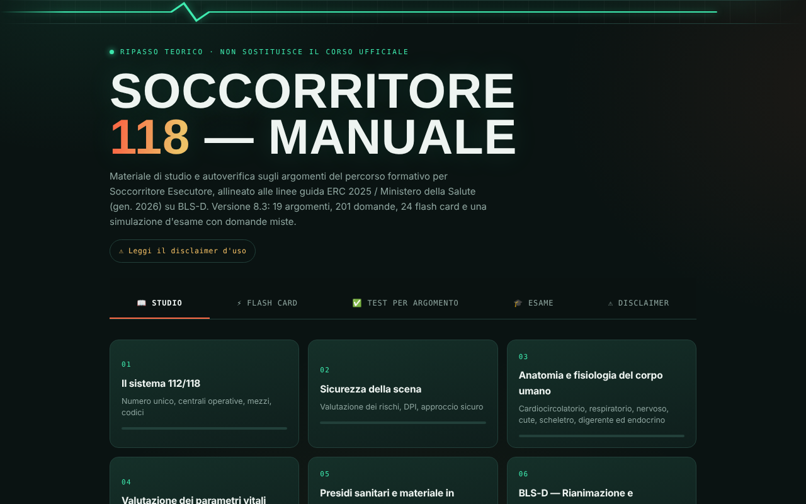

# Manuale Soccorritore 118

App di ripasso per il corso **Soccorritore Esecutore 118**: teoria divisa per argomenti, flash card per gli scenari critici, test per argomento e una simulazione d'esame. Funziona offline e si installa sul telefono come un'app.

> ⚠️ **Materiale non ufficiale.** È uno strumento di studio personale: non è un documento AREU, non rilascia certificazioni e non sostituisce il corso, le esercitazioni pratiche né le indicazioni degli istruttori del tuo ente di formazione.



## Cosa contiene

- **Studio**: 19 argomenti, dal sistema 112/118 al BLS-D, al trauma, alle emergenze pediatriche e agli aspetti legislativi.
- **Flash card**: schede sintetiche per consultare al volo le sequenze operative.
- **Test per argomento**: oltre 200 domande con spiegazione; le risposte vengono mescolate a ogni tentativo e il punteggio resta salvato sul dispositivo.
- **Simulazione esame**: 20, 30 o 50 domande miste da tutti gli argomenti, con tempo limite e revisione finale degli errori.
- **Segnala un errore**: ogni argomento e ogni domanda ha un link che apre una segnalazione già compilata qui su GitHub.

## Usarla

Apri il link dell'app dal telefono con Chrome o Safari e scegli **Aggiungi a schermata Home**. Dopo il primo caricamento funziona anche senza connessione.

Link: `https://davideparisimodena.github.io/118/` (attivo dopo aver abilitato GitHub Pages, vedi sotto).

### Pubblicarla con GitHub Pages

1. Nel repository vai su **Settings → Pages**.
2. In *Source* scegli **Deploy from a branch**, branch `main`, cartella `/ (root)`, poi **Save**.
3. Dopo un paio di minuti l'app è online all'indirizzo indicato nella stessa pagina.

### Provarla in locale

I service worker funzionano solo via http/https, non aprendo il file direttamente:

```bash
python3 -m http.server 8080
# poi apri http://localhost:8080/
```

## Struttura

| File | Contenuto |
|---|---|
| `content.js` | Tutti i testi: argomenti, domande dei test, flash card |
| `index.html` | Interfaccia e logica dell'app |
| `version.js` | Numero di versione, usato anche per aggiornare la cache offline |
| `sw.js` | Service worker per l'uso offline |
| `manifest.json`, `icon-*.png` | Dati per l'installazione come app |

## Modificare i contenuti

1. Modifica testi o domande in `content.js`. Ogni domanda ha la forma `{ q, opts, correct, ex }`, dove `correct` è la posizione della risposta giusta in `opts` (si parte da 0).
2. Aumenta `APP_VERSION` in `version.js` (per esempio da `8.3` a `8.4`).
3. Pubblica la modifica: chi ha l'app installata riceve la nuova versione alla successiva apertura con connessione.

## Fonti di riferimento

I contenuti seguono, per quanto riguarda il BLS-D, le linee guida ERC 2025 e le indicazioni nazionali. Per i protocolli operativi fanno fede i materiali del proprio ente di formazione.

- [European Resuscitation Council – Linee guida](https://cprguidelines.eu/)
- [Italian Resuscitation Council](https://www.ircouncil.it/)
- [AREU Lombardia](https://www.areu.lombardia.it/)

## Segnalazioni

Hai trovato un errore o un contenuto non aggiornato? Usa il link **⚑ Segnala un errore** nell'app oppure [apri una issue](https://github.com/davideparisimodena/118/issues/new), indicando possibilmente la fonte corretta.
